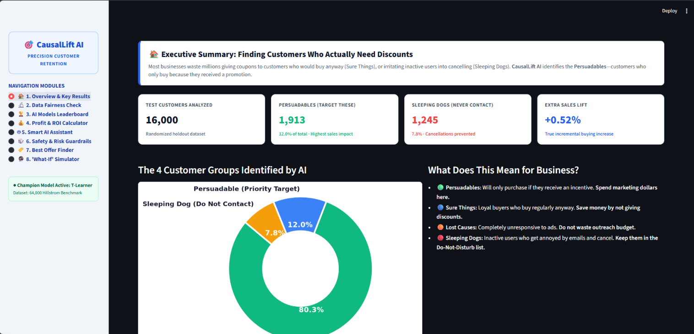

# CausalLift AI 🎯
### An AI-Powered Prescriptive Causal Uplift & Decision Intelligence Platform for Precision Marketing Optimization and Customer Retention

[](https://www.python.org/)
[](https://fastapi.tiangolo.com/)
[](https://streamlit.io/)
[]()
[]()
[](https://opensource.org/licenses/MIT)

---

## 🖥️ Executive Decision Intelligence Dashboard Preview

<div align="center">
  
  <p><em>Figure: Real-time CausalLift AI Decision Intelligence Dashboard featuring the 8 core analytical modules, Qini performance leaderboard, and financial ROI simulator.</em></p>
</div>

---

## 📌 Executive Summary

Traditional customer retention and digital marketing systems rely on standard **predictive machine learning** (e.g., churn classification $P(Y=1 \mid X)$). This conventional paradigm suffers from a critical conceptual flaw: **high purchase probability does not imply promotional responsiveness**. 

Standard propensity targeting causes massive marketing budget waste:
* **Subsidizing Organic Buyers ("Sure Things"):** Customers who would have purchased anyway receive unneeded discounts, burning corporate gross margins.
* **Provoking Negative Responders ("Sleeping Dogs"):** Dormant customers are disturbed by unwanted promotional messages, triggering unsubscribes, account churn, and direct revenue destruction.

**CausalLift AI** resolves this fundamental dilemma by shifting from correlational prediction to **prescriptive causal decision intelligence**. Grounded in the **Neyman-Rubin Potential Outcomes Framework**, the system isolates the **Conditional Average Treatment Effect (CATE)**:

$$\tau(X) \equiv \mathbb{E}\left[ Y(1) - Y(0) \mid X \right]$$

By identifying true incremental elasticity, CausalLift AI prescribes the exact commercial intervention (discount depth, voucher type, or silence) that maximizes enterprise Return-on-Investment (ROI) while guaranteeing statistical decision safety through distribution-free conformal inference.

---

## 🎯 The Four Causal Quadrants

```text
                      Treatment Responsiveness (Uplift τ)
                                      ▲
                                      │
                 Persuadables         │         Sure Things
            (TARGET WITH OFFERS)      │    (DO NOT WASTE PROMO!)
         Uplift: τ > 0 (High Lift)    │     Organic conversions
                                      │
  ────────────────────────────────────┼────────────────────────────────► Baseline Prob P(Y|0)
                                      │
                 Lost Causes          │        Sleeping Dogs
               (DO NOT TARGET)        │     (AVOID AT ALL COSTS)
          Unresponsive (τ ≈ 0.00%)    │   Outreach triggers churn (τ < 0)
                                      │
```

1. **Persuadables ($\tau > 0$):** Convert *only* when targeted with an incentive. This is the **sole quadrant** where marketing capital produces positive incremental profit.
2. **Sure Things ($Y(1)=1, Y(0)=1$):** Loyal customers who convert regardless of outreach. Subsidizing them dilutes gross margin.
3. **Lost Causes ($Y(1)=0, Y(0)=0$):** Completely unresponsive users where delivery cost is purely wasted.
4. **Sleeping Dogs ($\tau < 0$):** Inactive or privacy-conscious users provoked into unsubscribing by promotional spam.

---

## 📊 Empirical Benchmark Results (64,000-Customer RCT)

Evaluated on Kevin Hillstrom’s landmark MineThatData Randomized Controlled Trial (RCT) dataset ($N=64,000$, 100% common support, maximum $\text{SMD} = 0.0071 \ll 0.10$):

### 🏆 Meta-Learner Benchmark Leaderboard (Holdout $N=16,000$)

| Model Architecture | Qini Score | Top Decile Lift | Maximum Net Profit | Model Status |
| :--- | :---: | :---: | :---: | :---: |
| **T-Learner (Dual LightGBM)** | **8.69** | **+0.89%** | **+$5,010.53** | 🥇 **Champion Model** |
| **S-Learner (Single LightGBM)** | 6.39 | +0.81% | +$4,750.55 | 🥈 2nd Place |
| **X-Learner (Cross-Imputed CATE)**| 6.36 | +1.38% | +$4,924.92 | 🥉 3rd Place |

### 📈 Decile 1 Performance (Highest Predicted Lift)
* Evaluated across 1,600 holdout customers in Decile 1 (1,092 treated, 508 control):
  * **Treated Conversion Rate:** **1.282%**
  * **Control Conversion Rate:** **0.394%**
  * **Empirical Observed Lift:** **+0.888% (+0.89%)** ($p < 0.01$)
* **Sleeping Dogs Identification:** In Deciles 9 and 10, empirical uplift drops to negative values ($-0.08\%$ to $-2.05\%$), proving that the system successfully isolates users who churn when contacted.

### 💰 Campaign Financial ROI Simulation (30% Targeting Fraction)
* **Target Cohort:** Top 4,800 customers (Deciles 1–3).
* **Delivery Cost:** \$0.10 / contact (\$480.00 total campaign expenditure).
* **Gross Incremental Revenue:** **\$3,071.91** (Customer LTV = \$80.00).
* **Net Cash Profit:** **\$2,591.91**.
* **Net Campaign ROI:** **+540.0%**.

---

## 🔬 Scientific Methodology & Innovations

### 1. Honest Stratified Partitioning Protocol
* **Training Cohort (60%, $N=38,400$):** Fits base response surfaces $\mu_0(x)$ and $\mu_1(x)$.
* **Calibration Cohort (15%, $N=9,600$):** Reserved exclusively for distribution-free conformal quantile estimation.
* **Evaluation Cohort (25%, $N=16,000$):** Strictly held-out test cohort for unbiased causal benchmarking.

### 2. CATE Meta-Learners
* **S-Learner:** Fits $\mu(x, w) = \mathbb{E}[Y \mid X=x, W=w]$. Suffers from regularization shrinkage bias in sparse conversion domains.
* **T-Learner (Champion):** Fits separate surfaces $\mu_0(x)$ on control and $\mu_1(x)$ on treatment. Completely avoids shrinkage bias.
* **X-Learner:** Computes counterfactual imputed residuals $\tilde{D}_1$ and $\tilde{D}_0$, combining second-stage predictions using propensity scores $e(x)$.

### 3. Distribution-Free Split-Conformal Safety Guardrails
* Avoids dangerous Gaussian asymptotic assumptions on sparse binary labels.
* Calibrates non-conformity residuals on 9,600 held-out units ($q_{\text{ctrl}} = 0.0056, q_{\text{treat}} = 0.0233$).
* Produces certified finite-sample bounds $[\tau_{\text{lower}}, \tau_{\text{upper}}]$.
* **Guaranteed Persuadable Rule:** When $\tau_{\text{lower}} > 0.002$ (+0.2% lift), the user is certified **Safe to Target** at a **93%–99% statistical confidence level**.

### 4. Multi-Treatment Economic Optimizer
* Solves the profit-maximizing allocation:
  $$a^*(X) = \arg\max_{a \in \mathcal{A}} \left[ \tau_a(X) \times \text{LTV} - \text{Cost}(a) \right]$$
* **Key Commercial Finding:** While a 20% deep discount generates +3.50% lift (\$2.45 net profit at \$0.35 cost), the **Free Shipping Voucher** achieves +3.53% lift at \$0.20 cost, generating the highest net return (**\$2.62/customer, 1,311.2% ROI**).

### 5. Algorithmic Counterfactual Recourse
* Extracts surrogate decision trees to yield transparent human-readable policies:
  * $\text{Spend History} \le \$356.91 \implies$ Suppress outreach (near-zero elasticity).
  * $\text{Spend History} > \$356.91 \implies$ Target with Free Shipping.
  * Channel migration simulations demonstrate that moving phone-bound shoppers to digital web channels restores $+1.8\%$ promotional responsiveness.

---

## 🎛️ The 8 Dashboard Analytical Modules

| Tab | Module Name | Core Capabilities |
| :---: | :--- | :--- |
| **1** | **Executive Overview** | High-level KPI cards, total uplift, campaign revenue gain, and live model status. |
| **2** | **RCT Fairness Diagnostics** | Covariate balance verification, SMD distribution plots, and Common Support overlap. |
| **3** | **CATE Leaderboard** | Side-by-side comparison of T-Learner, S-Learner, and X-Learner with Qini curves. |
| **4** | **Financial ROI Simulator** | Interactive slider for contact costs, customer LTV, and decile cutoff budget optimization. |
| **5** | **GenAI Causal Copilot** | Prescriptive natural-language executive briefs and real-time personalized copy generation. |
| **6** | **Conformal Safety Visualizer**| Finite-sample predictive confidence bands and *Guaranteed Persuadable* risk tagging. |
| **7** | **Multi-Offer Policy Simulator**| Economic payoff matrix across competing promo tiers (10%, 20%, Free Shipping). |
| **8** | **What-If Recourse Sandbox** | Interactive customer-level counterfactual simulator exploring channel and recency interventions. |

---

## ⚡ FastAPI Production REST Endpoints

The system exposes sub-50ms inference microservices for automated CRM webhooks (Salesforce, HubSpot, Braze):

| Method | Endpoint | Description |
| :---: | :--- | :--- |
| `GET` | `/health` | Microservice heartbeat, model metadata, and pipeline calibration status. |
| `POST` | `/predict-uplift` | Generates individual CATE point estimate $\hat{\tau}(X)$ and quadrant classification. |
| `POST` | `/conformal-predict` | Computes 93%–99% finite-sample uncertainty bounds $[\tau_{\text{lower}}, \tau_{\text{upper}}]$. |
| `POST` | `/multi-treatment-opt`| Evaluates competing promotional offers and returns the profit-maximizing action. |
| `POST` | `/what-if-simulate` | Simulates counterfactual channel and recency interventions for algorithmic recourse. |
| `POST` | `/copilot-brief` | Generates LLM-ready executive briefing summaries and dynamic ad creatives. |

---

## 🛠️ Repository Architecture

```text
CausalLift-AI/
├── assets/
│   └── dashboard_preview.png         # High-resolution dashboard screenshot
├── data/
│   ├── raw/
│   │   └── minethatdata_email.csv    # Landmark 64,000-customer RCT dataset
│   └── processed/                    # Cleaned feature splits
├── models/
│   ├── best_uplift_model.pkl         # Champion T-Learner LightGBM model
│   ├── conformal_predictor.pkl       # Calibrated non-conformity quantiles
│   └── feature_names.pkl             # Canonical feature schema
├── reports/
│   ├── benchmark_leaderboard.csv     # Official model leaderboard metrics
│   ├── t_learner_deciles.csv         # Granular 10-decile conversion statistics
│   ├── t_learner_roi_simulation.csv  # Financial ROI curve simulation data
│   ├── smd_covariate_balance.csv     # Standardized Mean Differences diagnostics
│   └── policy_decision_rules.txt     # Extracted surrogate decision rules
├── src/
│   ├── data_loader.py                # Dataset acquisition & stratified splitting
│   ├── causal_validation.py          # Positivity & SMD balance diagnostics
│   ├── meta_learners.py              # S-Learner, T-Learner, X-Learner implementations
│   ├── evaluation.py                 # Qini curves, AUUC, deciles, ROI simulations
│   ├── explainability.py             # Quadrant segmentation & Policy Tree rules
│   ├── causal_copilot.py             # GenAI Counterfactual Reasoner & Dynamic Copy Generator
│   ├── conformal_uplift.py           # Split-conformal uncertainty intervals
│   ├── multi_treatment_optimizer.py  # Multi-offer profit maximization optimizer
│   ├── counterfactual_simulator.py   # 'What-If' recourse simulation engine
│   └── pipeline.py                   # Master end-to-end training orchestration
├── app/
│   ├── api.py                        # FastAPI microservice (6 REST endpoints)
│   └── dashboard.py                  # Interactive Streamlit executive dashboard (8 Tabs)
├── test_api.py                       # Automated integration test suite (6/6 tests passing)
├── requirements.txt                  # Production dependency specifications
├── Dockerfile                        # Containerized deployment manifest
└── README.md
```

---

## 🚀 Quickstart Guide

### 1. Environment Setup
```bash
# Clone the repository
git clone https://github.com/ShreyaBawankule/CausalLift-AI.git
cd CausalLift-AI

# Create and activate virtual environment
python -m venv .venv
.\.venv\Scripts\activate   # Windows
# source .venv/bin/activate # Linux/macOS

# Install dependencies
pip install -r requirements.txt
```

### 2. Run the End-to-End Pipeline
Executes data validation, meta-learner training, conformal calibration, and leaderboard persistence:
```bash
python -m src.pipeline
```

### 3. Launch the Interactive Decision Dashboard
```bash
streamlit run app/dashboard.py
```
*Access the UI in your browser at `http://localhost:8501`.*

### 4. Launch the FastAPI Microservice
```bash
uvicorn app.api:app --reload --port 8000
```
*Interactive Swagger documentation available at `http://localhost:8000/docs`.*

### 5. Run Integration Tests
```bash
python test_api.py
```

---

## 👩‍💻 Project Authors & Academic Credentials

* **Authors:**
  * **Shreya Bawankule** (`shreyabawankule525@gmail.com`)
  * **Mayur Shende** (`mayurshende200121@gmail.com`)
* **Degree:** Bachelor of Technology in Robotics & Artificial Intelligence with **Honors in Data Science**
* **Project Supervisors:**
  * **Prof. Sakshi Chakole**, Assistant Professor (Project Guide)
  * **Dr. (Mrs.) M. V. Vyawahare**, Head of Department
* **Department:** Department of Robotics and Artificial Intelligence
* **Institution:** Priyadarshini College of Engineering (PCE), Nagpur, Maharashtra, India
* **Affiliated University:** Rashtrasant Tukadoji Maharaj Nagpur University (RTMNU)

---

## 📚 Academic Citation (BibTeX)

```bibtex
@inproceedings{bawankule2026causallift,
  title     = {CausalLift AI: An AI-Powered Prescriptive Causal Uplift and Decision Intelligence System for Precision Customer Retention and Marketing Optimization},
  author    = {Bawankule, Shreya and Shende, Mayur and Chakole, Sakshi and Vyawahare, M. V.},
  booktitle = {Proceedings of the 2026 IEEE International Conference on Emerging Trends in Engineering & Technology (ICETET)},
  year      = {2026},
  address   = {Nagpur, India}
}
```

---

## 📄 License
This project is licensed under the [MIT License](LICENSE).
